# E9.1 Administrator Visual Review

**Review date:** 2026-10-27 
**Branch:** `feature/e9.1-admin-foundation` 
**Reference:** `../prototype.html` 
**Capture method:** Prototype rendered directly; React rendered from Vite with temporary browser-request interception returning API-shaped auth/church/election payloads. Interception exists only in `capture-react.mjs`; no mock data or simulation logic was added to the app. 
**Viewports:** 1280×800 desktop and 390×844 mobile. Full-page screenshot files retain page height as required to capture the complete screen.

## Screenshots

| State | Prototype | React |
| --- | --- | --- |
| Sign-in, 1280px | 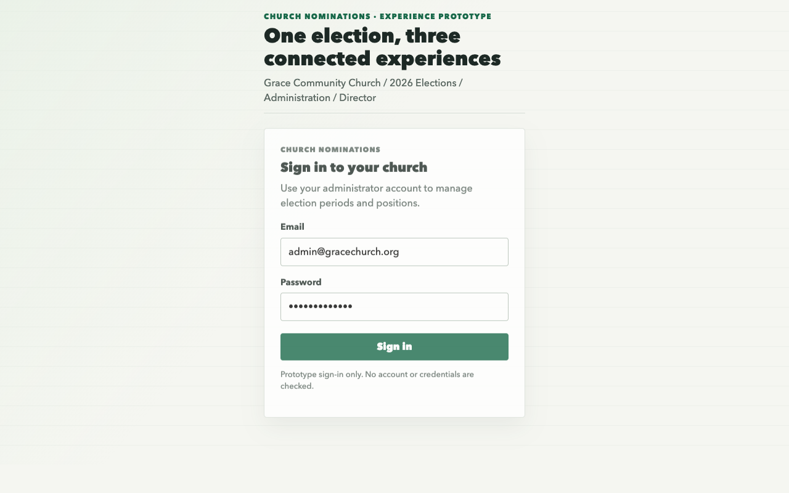 | 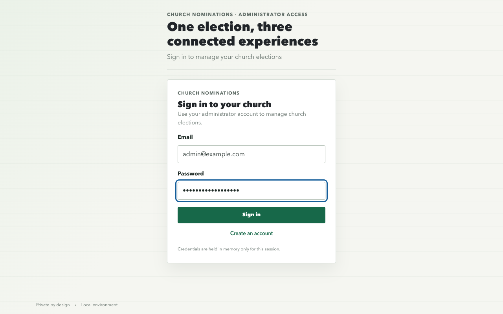 |
| Sign-in, 390px | 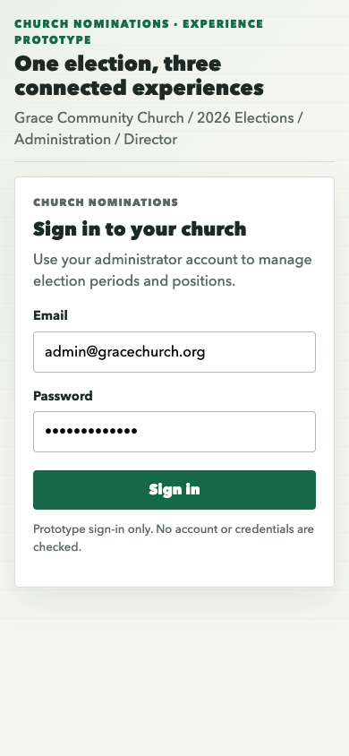 | 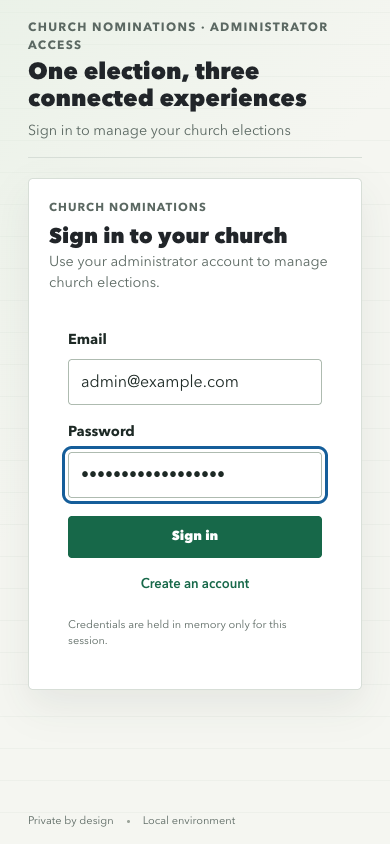 |
| Church dashboard, 1280px | 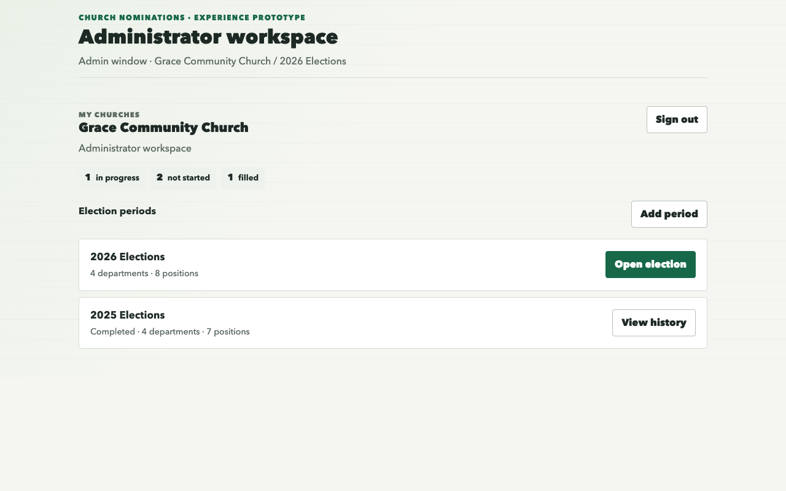 | 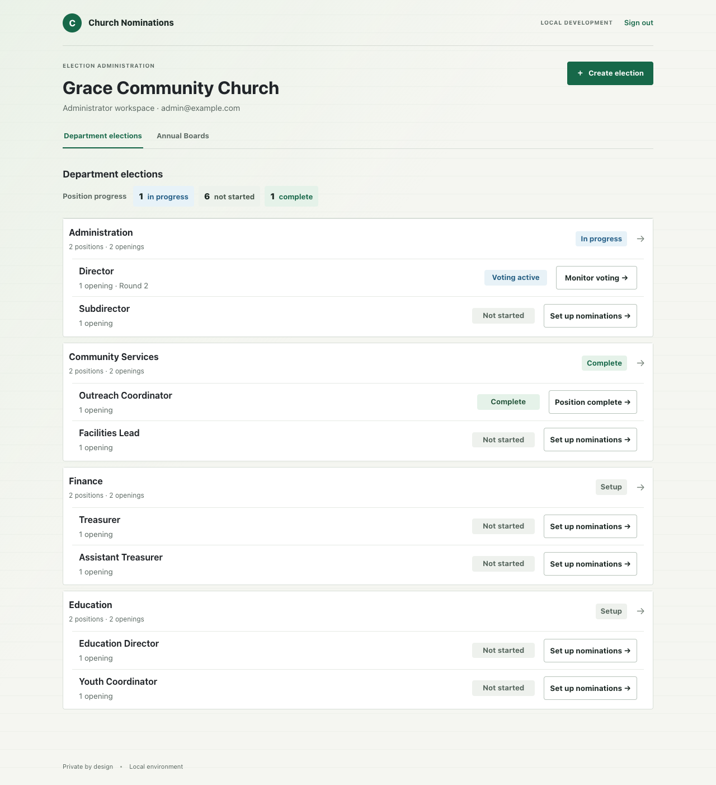 |
| Church dashboard, 390px | 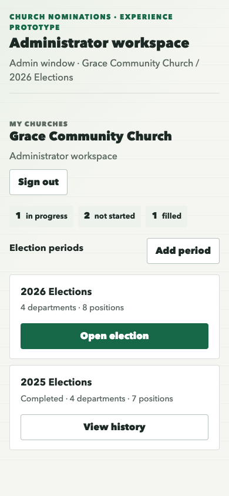 | 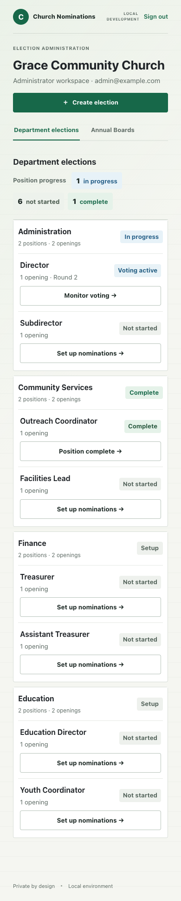 |
| Election overview, 1280px | 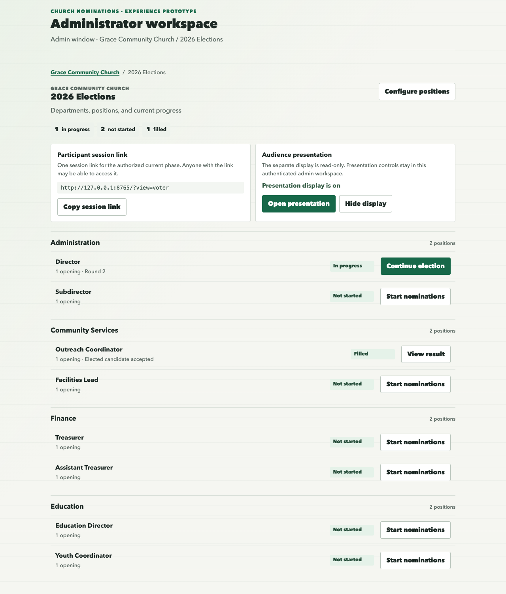 |  |
| Election overview, 390px | 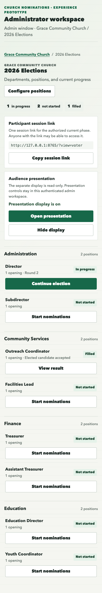 |  |
| Position navigation, 1280px | 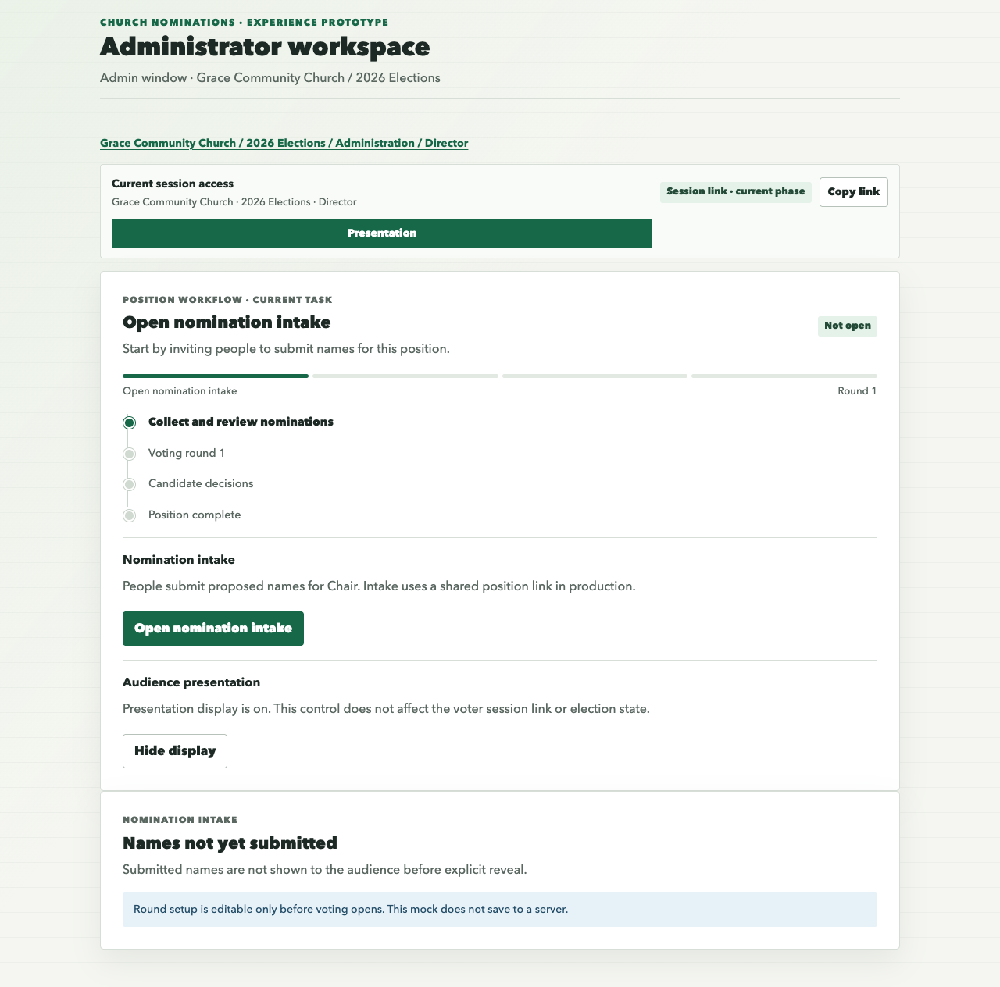 | 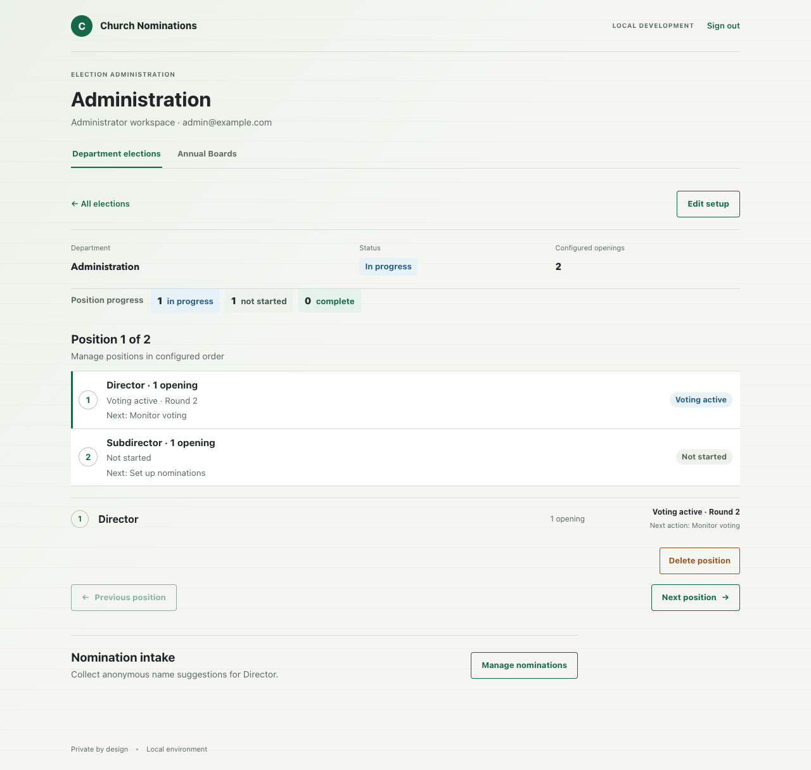 |
| Position navigation, 390px | 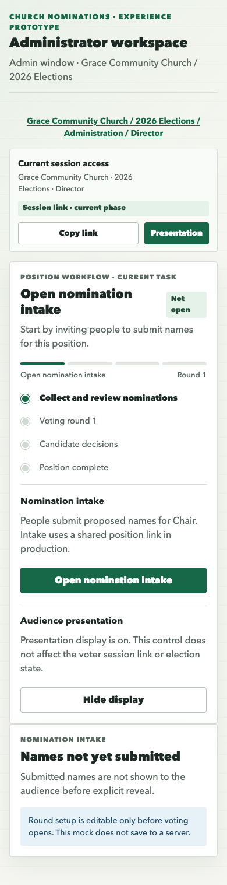 | 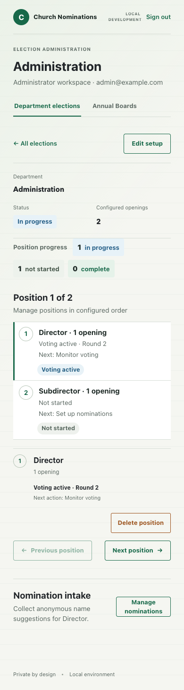 |

## Comparison

- **Sign-in:** Updated to use the prototype's context masthead, centered bordered white form panel, ruled pale background, Avenir Next system stack, green action, and comparable field sizing. Product-specific registration and credentials-in-memory text remain because they are real application behavior. The React masthead retains truthful sign-in context rather than sample church/year data.
- **Church dashboard:** The prototype shows position counts and election-period cards. The production API has no election-period/year entity, so React cannot truthfully reproduce 2025/2026 period cards or historical period actions. The authenticated app keeps its real church shell and Department elections/Annual Boards navigation.
- **Election overview:** React now uses the prototype's restrained ruled background, bordered department groupings, readable position rows, status chips, and clear next-action controls. It renders all positions from authenticated API data. The prototype's 2026 breadcrumb and period heading are intentionally omitted because the domain/API has no period field. Sample mock status totals are replaced by actual API-derived totals; production uses `Complete` rather than prototype-only `Filled` wording.
- **Position navigation:** React keeps its existing ordered, keyboard-operable selector, unsaved-draft protections, and detail workflow. Type size and status/action hierarchy have been brought closer to the prototype. The prototype's focused task panel, session-link copy, and presentation controls are not all represented here: stable participant session routing remains E6.11 work and presentation/result controls remain owned by E6.8/E6.9. Adding those during this visual correction would exceed the approved slice.
- **Mobile:** At 390px, department/position content stacks and next actions are full width. Browser capture reported no horizontal overflow. The page remains vertically longer than the prototype due to the actual authenticated navigation and complete election list.

## Remaining Differences For Product Owner Review

1. The API has no election-period abstraction; adding the prototype's year/period dashboard requires a separately approved product/domain/API change or a decision to treat departments as the first production overview level.
2. The prototype's position task frame includes session-link and presentation controls. Those are dependent on E6.11 participant-link implementation and E6.8 presentation controls; they were intentionally not added in this first-slice correction.
3. The React position detail includes existing position administration controls (delete, previous/next, nomination panel) not present in the overview prototype screen. They remain to preserve existing functionality and belong to later workflow-specific visual slices.
4. Exact platform font rendering varies; React uses the local `Avenir Next, Avenir, Segoe UI` stack requested by the prototype. The capture makes no external Google Fonts request.

These are the remaining intentional differences. No simulated period, mock election outcomes, voter/presentation workflow, or candidate-response functionality was introduced.

## Prototype-Only Term and Accordion Follow-up (2026-10-28)

- Product Owner approved the first slice with a minor styling correction: the React term rows now use the full available content width rather than stopping at 760px. Desktop and mobile captures confirm the rows fill their container without horizontal overflow.
- The post-login Administrator Workspace now offers sample `Elections 2026` and `Elections 2027` terms. These are explicitly labeled prototype-only; the current election API still has no election-period/year association. Live API election rows are shown under the selected sample term for visual presentation and are not filtered or persisted by term.
- Department election rows now use a Bootstrap accordion for position density, with a separate department row continuing to the existing detail workflow. The position action label is `Configure Position`.
- The election overview shows `sample://` voting and presentation link examples labeled `DEMO LINK · NOT ACTIVE`; they are not routable, copyable, or bound to the real voter/presentation APIs.
- The static prototype was updated to show the same term chooser, term heading, department accordions, label, and inert demo links. Its browser flow passed at 1280px and 390px: four department accordions rendered, the first collapsed/reopened, and no horizontal overflow was detected.
- The React browser fixture run showed Elections 2027, four department rows, two inactive link indicators, and a working collapse/reopen interaction with no console/network errors or horizontal overflow. Full frontend tests: 82 passed; lint: 0 errors with existing warnings; production build passed.
- The selected sample term is a visual-only grouping, not a persisted filter: the same live API election rows are shown under either sample term. The browser test and sample-state copy state this limitation explicitly. A real historical/term-based selection needs an election-period model and API contract.
- By request, the standalone prototype now includes the same sample term chooser and department accordion presentation. Its `sample://` voting/presentation values are display-only and do not open its role windows.

## Annual Boards Responsive Migration (2026-10-28)

- The existing Annual Boards detail uses Bootstrap responsive columns for the roster and sessions: two equal columns at desktop and a single stacked column at 390px. Board-year, roster, and recorded-session summaries use responsive Bootstrap columns and stack on mobile.
- Session selection and attendance use Bootstrap list groups with the existing React state and API calls. The attendance privacy note, named roster, per-session selection, and explicit save action are unchanged.
- Browser-only API-shaped data was used to exercise the real authenticated navigation. At 1280px, roster and sessions each measured 540px and shared the same vertical start; at 390px, both measured 358px and stacked vertically. Three attendance checkboxes rendered at both sizes; document overflow was false; console errors and failed requests were zero.
- Screenshots: `react-annual-board-1280.png` and `react-annual-board-390.png`. Reproduction: `capture-boards.mjs`.
- The prototype does not contain an Annual Boards reference, so this validates responsive implementation and retained behavior rather than direct prototype fidelity. Product Owner visual review remains pending.
- Validation: Annual Boards/attendance focused tests passed (3); full frontend suite passed (82); lint reported zero errors with the existing TypeScript/parser support warning and existing `src/main.tsx` non-null assertion warning; production build passed.
